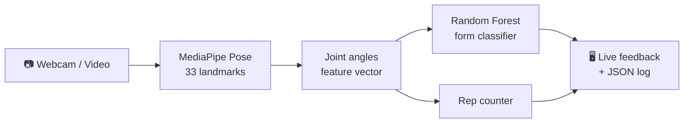

<div align="center">

# 🏋️ Smart Gym Trainer

### Real-time exercise form checker & rep counter using AI pose detection


**Squats · Push-ups · Bicep Curls**

</div>

---

## 📑 Table of Contents

- [Overview](#-overview)
- [Features](#-features)
- [How It Works](#-how-it-works)
- [Project Structure](#-project-structure)
- [Quick Start](#-quick-start)
- [Build Your Dataset](#-build-your-dataset)
- [Train the Models](#-train-the-models)
- [Run the Trainer](#-run-the-trainer)
- [Controls](#-controls)
- [Tuning](#-tuning)
- [Tech Stack](#-tech-stack)

---

## 🎯 Overview

Smart Gym Trainer watches you exercise through a webcam (or a video file), counts your reps and tells you
instantly whether your form is correct. Everything runs **locally on a laptop CPU**, with no cloud and no special hardware.

## ✨ Features

| | Feature | Description |
|---|---|---|
| 🦴 | **Pose detection** | MediaPipe Pose tracks 33 body landmarks in real time |
| 📐 | **Joint-angle features** | Knee, hip, elbow and back angles computed per frame |
| 🤖 | **Form classification** | A Random Forest per exercise labels each frame correct or incorrect |
| 🔢 | **Rep counting** | Angle-threshold state machine counts completed reps |
| 💬 | **Live feedback** | On-screen skeleton, rep count and form hints |
| 🧾 | **Session logs** | Every rep is saved to `logs/session_*.json` |
| 🛟 | **Works without training** | Falls back to rule-based form checks if no model exists |

## 🧠 How It Works



## 📁 Project Structure

```
smart_gym/
├── helpers.py          # Pose estimation, angle maths, features, rule-based checks
├── collect_data.py     # Build the joint-angle dataset from videos or webcam
├── train_model.py      # Train one Random Forest per exercise + evaluation report
├── live_app.py         # Real-time trainer (the main app)
├── requirements.txt    # Python dependencies
├── videos/             # (you create) recorded videos, sorted by class
├── data/               # generated CSV datasets
├── models/             # trained models, confusion matrices, report.json
└── logs/               # per-session rep logs
```

## 🚀 Quick Start

> Requires **Python 3.10 or 3.11**.

```bash
git clone https://github.com/adhilmm18/smart_gym.git
cd smart_gym

python -m venv venv
venv\Scripts\activate            # Windows  (Linux/macOS: source venv/bin/activate)
pip install -r requirements.txt
```

Try it right away, **no training needed**:

```bash
python live_app.py --exercise curl
```

Without trained models it uses rule-based form checks.

> 💡 On first run, a ~6 MB pose model may be downloaded into `models/` (depends on your MediaPipe version).
> If you are offline, download it from the URL shown in the error and save it at the path shown.

## 🎥 Build Your Dataset

Record videos (**side view, whole body visible, 720p, fixed camera**) and sort them like this:

```
videos/
├── squat/   ├── correct/   └── incorrect/
├── pushup/  ├── correct/   └── incorrect/
└── curl/    ├── correct/   └── incorrect/
```

**Tips for a good dataset**

- 👥 Use several people (all team members if possible)
- 👕 Vary clothes, rooms and lighting
- 🎬 Record 10+ videos per class
- 🏷️ Name files by person, e.g. `adil_01.mp4`

Then extract the features:

```bash
python collect_data.py
```

Or record live from the webcam:

```bash
python collect_data.py --webcam --exercise curl --label incorrect --person salvi
```

## 🎓 Train the Models

```bash
python train_model.py
```

Outputs:

| File | Contents |
|---|---|
| `models/<exercise>_model.joblib` | Trained classifier |
| `models/<exercise>_confusion_matrix.png` | Confusion matrix plot |
| `models/report.json` | Accuracy, precision, recall, F1 |

> ⚠️ The 80/20 train/test split is done **per video**, not per frame. Neighbouring frames are nearly identical, so a frame-level split would leak data and give fake ~99% accuracy.

## ▶️ Run the Trainer

```bash
python live_app.py --exercise squat        # webcam
python live_app.py --source my_video.mp4   # video file
```

Each completed rep is logged to `logs/session_*.json`.

## ⌨️ Controls

| Key | Action |
|:---:|---|
| `1` | Switch to Squat |
| `2` | Switch to Push-up |
| `3` | Switch to Bicep Curl |
| `R` | Reset counters |
| `S` | Save session log |
| `Q` / `Esc` | Quit |

## 🔧 Tuning

Open `helpers.py` and adjust on your own videos if reps are missed or hints fire too often:

- `REP_THRESHOLDS` - angles used for rep counting
- `rule_check()` - thresholds for form hints

## 🛠️ Tech Stack

**MediaPipe** · **OpenCV** · **NumPy** · **pandas** · **scikit-learn** · **joblib** · **Matplotlib**

---

<div align="center">

Made with 💪 for smarter workouts

</div>
